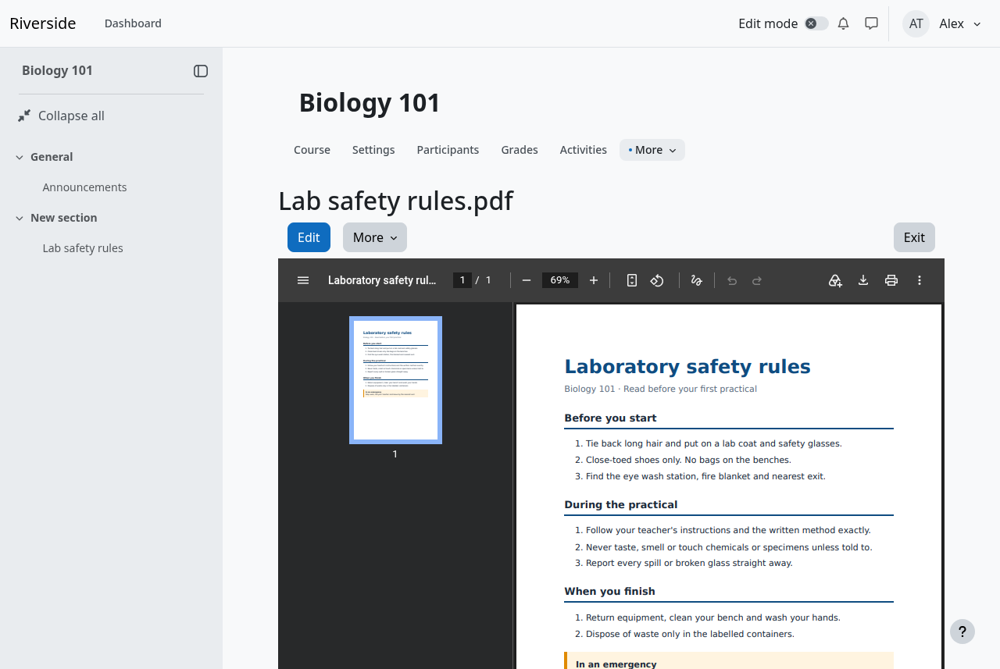

# Media bank for Moodle

Upload a video, audio file, PDF or picture to Moodle's **Content bank** once, and use it in as many courses as you like.
In a course, a teacher picks the file with Moodle's own file picker and chooses:

- **Link to the file**: the course follows the bank item. Replace the item and every course that links to it gets the new file.
- **Make a copy of the file**: the course gets its own file that never changes.

Status: **Beta**. Released for testing, so try it on a copy of your site first. For Moodle **5.0 to 5.3**.

## What is in this repository

| Plugin | Folder | Version | Needs |
|---|---|---|---|
| Media bank content type (`contenttype_mediabank`) | `contenttype_mediabank/` | 0.10.0 | Moodle 5.0 to 5.3 |
| Media bank tools (`local_mediabank`) | `local_mediabank/` | 0.3.0 | the content type |

Install the content type first. Each plugin has its own README and `CHANGES.md`.

## What it does

- **Upload checks.** A file's content must match its name, so a document renamed to `.png` is refused. Kinds and size limits are
  settings: video (mp4, webm), audio (mp3, m4a, ogg), PDF, images (png, jpg, gif, webp).
- **Where it is used.** An item's page lists the courses that link to it. An item that courses link to cannot be deleted by accident.
- **Replace and undo.** Replacing an item updates every link. The old file is kept as a version (30 days by default) and can be put back.
- **Accessibility fields.** Text alternative (required for images), transcript, and WebVTT captions.
- **Streaming.** An uploaded MP4 gets its index moved to the front by a background task, so playback can start before the whole
  file has downloaded. Nothing is re-encoded and nothing extra needs installing on the server.
- **Access control.** Files are served only to people who may see the item, and an item can be made unlisted.
- **Backup and restore** (`local_mediabank`). Optionally, course backups carry the linked files, which a restore on another site
  turns into ordinary copies.
- **Web services** (read only), **privacy (GDPR)** support, **events**, and command-line tools for administrators.

If a person's account is erased, courses that linked to their media keep the file as an ordinary copy.

## Install

1. Download `contenttype_mediabank_<version>.zip` and `local_mediabank_<version>.zip` from the
   [releases page](https://github.com/billsensei/moodle-repository_mediabank/releases).
   The release page also has `mediabank-<release>-bundle.zip`, which holds both plugins and the guides.
2. In Moodle, go to **Site administration → Plugins → Install plugins** and install the content type, then the tools.
3. Settings are under **Site administration → Plugins → Content bank → Media bank**.

Full steps, including installing by hand, are in [docs/INSTALL.md](docs/INSTALL.md).

## Guides

- [Install guide](docs/INSTALL.md)
- [Administrator guide](docs/ADMIN-GUIDE.md): settings, scheduled tasks, large files, backup, privacy, web services, what has been tested
- [Teacher guide](docs/TEACHER-GUIDE.md): upload, link or copy, replace, accessibility, with screenshots

## Tested

- Moodle 5.0, 5.1, 5.2 and 5.3, on PHP 8.3 and 8.4, with PostgreSQL and MariaDB, by the GitHub Actions workflow in
  `.github/workflows/ci.yml` (32 jobs: code style, PHPDoc, PHPUnit and Behat for both plugins).
- Moodle's own privacy and event checks.

## Known limits

- Beta software. Back up your site before installing, and try it on a copy first.
- Captions, text alternative and transcript stay with the bank item. A course that links to or copies the file gets the bare file.
- Streaming preparation only moves the index of plain MP4 files. It does not re-encode, shrink or resize a video, and it does not
  touch `.webm` or `.m4a` files.
- A teacher cannot convert only their own course's link into a copy. They can pick the item again and choose **Make a copy**;
  a manager can convert all links from the item's Edit page.
- The plugin cannot check whether a PDF is tagged for screen readers.
- Not tested: the Moodle mobile app (no mobile support), Oracle and SQL Server, and activities other than the **File** resource
  for the Link and Copy choice.

## Building the release files

    python3 scripts/build_release.py --out dist
    php scripts/validate_plugin_zip.php --moodle=/path/to/moodle --zip=dist/<plugin zip> --component=contenttype_mediabank

The build is reproducible: the same commit gives the same files. [docs/COMMANDS.md](docs/COMMANDS.md) is a running record of
the commands used to test, build and release, with their results.

## Licence

Copyright 2026 SenseiMoodle. Released under the GNU General Public License, version 3 or later, the same as Moodle.
