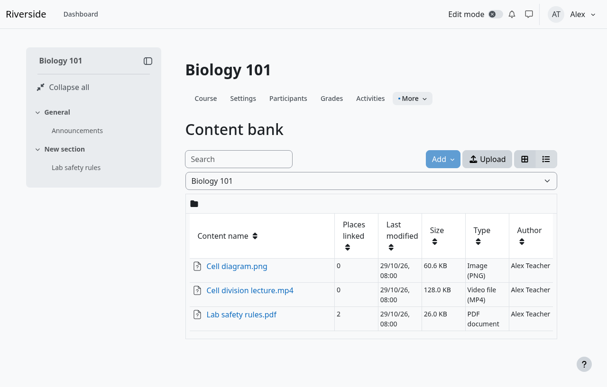
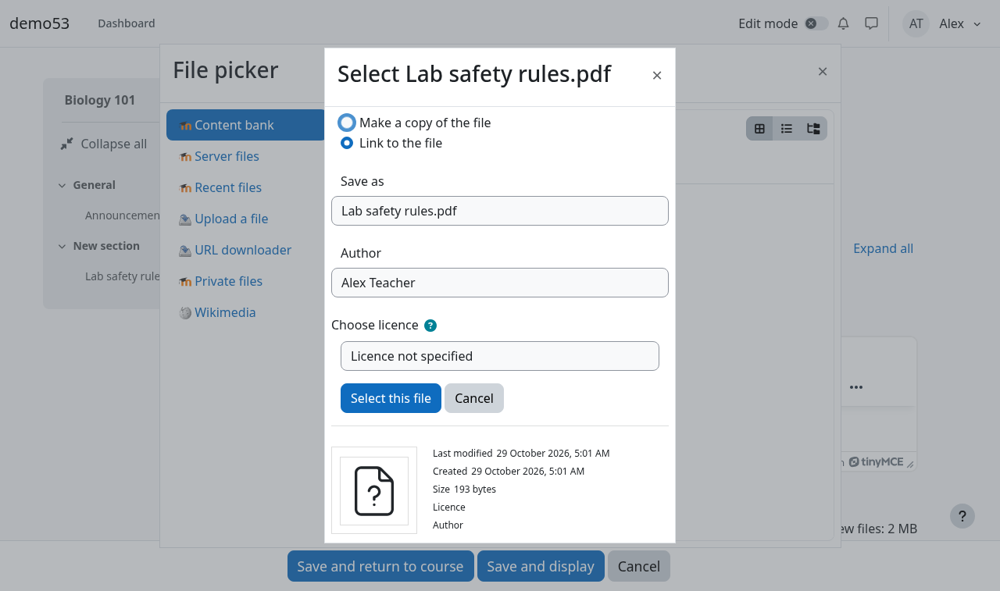
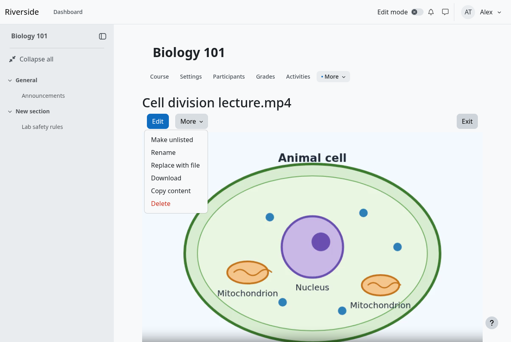
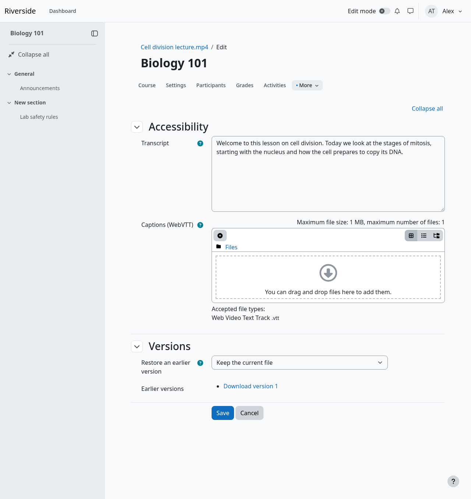
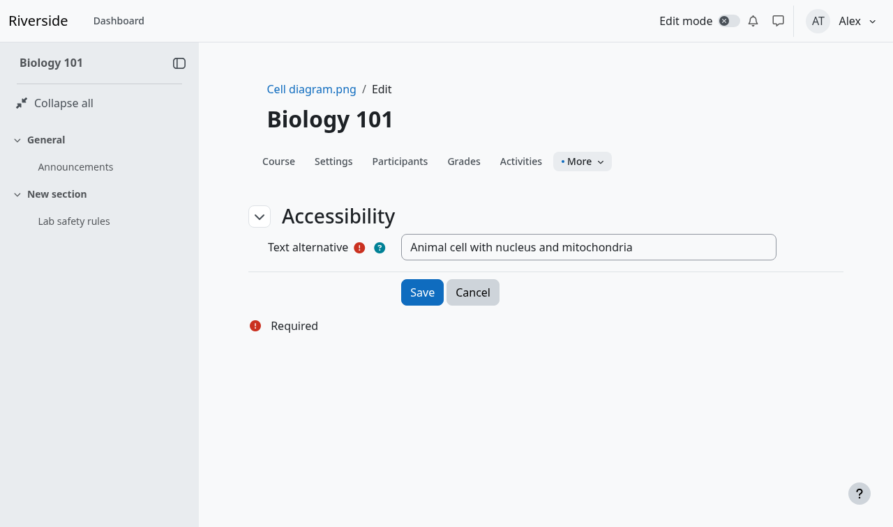
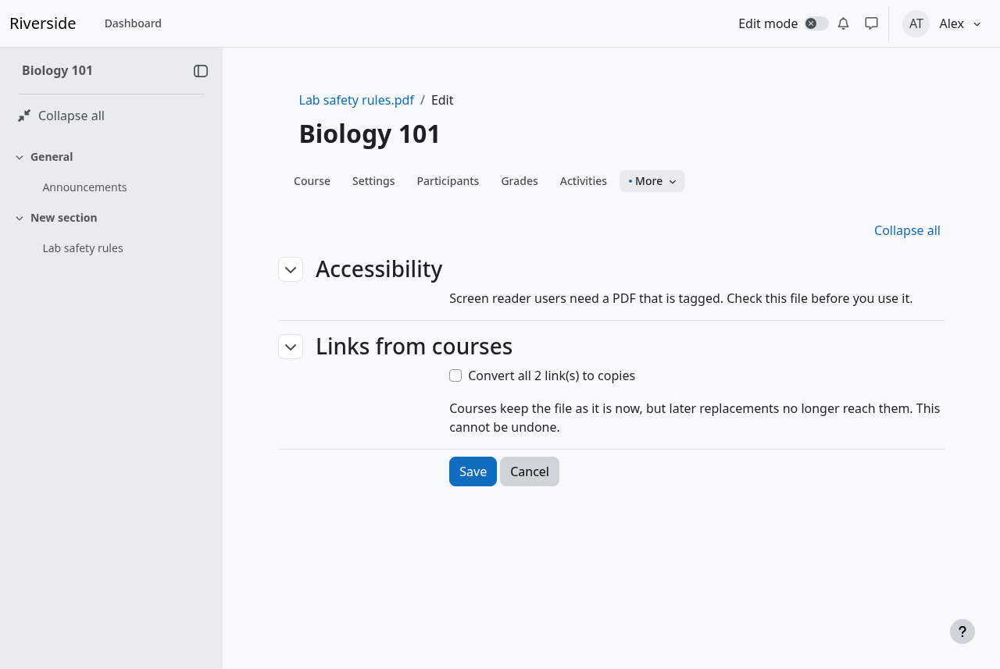

# Media bank: Teacher guide

The Media bank lets you upload a video, audio file, PDF or picture **once** and use it in as many courses as you like. If the file needs correcting, you fix it in one place.

**In short**
1. Upload the file to the **Content bank**.
2. In a course, add it to an activity such as a **File** resource and choose **Link to the file** or **Make a copy of the file**.
3. To change the file later, use **Replace with file** on the item. Every course that *links* to it gets the new file.

---

## 1. Upload a file

1. Open your course and go to the **Content bank**. It is in the course menu, usually under **More**.
2. Click **Upload**.
3. Click **Choose a file...**, pick your file (or drag it in), then click **Save changes**.

The file now appears in the list. Click its name to open its page, where you can play or view it.

**Will my video start quickly?** If your site has it switched on (it is by default), an MP4 video is prepared for streaming a few minutes after you upload it, so students can start watching before the whole file has downloaded. Nothing about the picture or sound changes. It is done by the server in the background; there is nothing for you to do. The file you uploaded is kept as an earlier version (see section 5).

**Which files are allowed?** Videos (mp4, webm), audio (mp3, m4a, ogg), PDFs and images (png, jpg, gif, webp and, if your site allows it, svg). Your site administrator sets the size limits. By default they are 1 GB for video, 200 MB for audio, 100 MB for PDFs and 20 MB for images.

**Why was my file refused?** The Media bank checks what is *inside* a file, not only its name. You will see a message such as:

| Message | What it means | What to do |
|---|---|---|
| "…content is not the kind of file its name says" | The file is not really what its name says, for example a document renamed to `.png`. | Export it again in the right format. |
| "…this kind of file is not allowed" | Your site does not accept this kind of file. | Ask your administrator. |
| "…larger than the limit of …" | The file is too big. | Compress it, or ask your administrator. |
| "…an SVG file may contain only a picture…" | The SVG has a script, animation, an embedded page or a link that loads something, or is damaged. | Export it again as a plain SVG, or as a PNG. |
| "…is empty" | The file has nothing in it. | Check the original and upload again. |

A very large file can also fail because of a limit on the server, and then there may be no clear message. If that happens, ask your administrator to check the upload limits.

## 2. Use it in a course

Here the example is a **File** resource.

1. In your course, turn editing on and **add a File** (**Add an activity or resource → File**).
2. Give it a name. In **Select files**, click **Add...**.
3. In the list on the left, choose **Content bank**.
4. Click the item you want.
5. Choose how to use it:
   - **Link to the file** (already selected)
   - **Make a copy of the file**
6. Click **Select this file**, then **Save and return to course**.

### Link or copy?

| | **Link to the file** | **Make a copy of the file** |
|---|---|---|
| What the course gets | A pointer to the item in the bank | Its own separate file |
| If you replace the item later | **The course gets the new file** | Nothing changes |
| If the item's course or category is deleted, or the item is moved by Moodle | The course keeps its file, **as a copy** that no longer follows replacements | Nothing changes |
| Best for | Material you maintain in one place and want kept up to date | A snapshot that must never change under you |

**If in doubt, keep Link.** Choose a copy when this course must not change even if somebody later replaces the original.

Only the **File** resource has been tested with this choice. Other activities that use Moodle's standard file picker should offer the same two choices.

## 3. The item page

Click an item's name in the Content bank. You see the preview, then:

**Where this item is used** lists the courses that link to it, with the number of links in each, for example *"Course 1: 1 link(s)"*. Courses you are not allowed to see are counted but not named.

If courses link to the item, the page also says: *"This item cannot be deleted while courses link to it."* The **Delete** option is not offered. That protects those courses. To delete the item, first convert the links to copies (see section 6).

## 4. Replace a file

Use this when the file needs correcting and you want every course that links to it to get the fix.

1. Open the item's page.
2. Open the **More** menu and choose **Replace with file**, then pick the new file.

3. Save.

Things to know:
- The new file must be the **same kind of file**: a `.pdf` can only be replaced by a `.pdf`. This keeps the links working.
- Courses that **link** to it show the new file straight away. Courses that took a **copy** are not changed.
- The old file is **kept for a while** (30 days unless your administrator changed it). You can bring it back: see section 5.

## 5. Make it accessible, and undo a replacement

On the item's page, click **Edit**.

| Field | What it is for |
|---|---|
| **Text alternative** | **Required for images.** Describe the picture for people who cannot see it. You cannot save an image without it. |
| **Transcript** | For video and audio. The words spoken, as text. It is shown under the preview in the bank. |
| **Captions (WebVTT)** | For video and audio. Upload a `.vtt` caption file. They are shown on the item's page. |
| **Restore an earlier version** | Choose an older file to put back. This changes it for every course that links to the item. The file it replaces is kept, so you can undo the undo. |

Saving shows *"Content updated"*.

This is the Edit page of a video. The text alternative of an image is on the same page, and cannot be left empty:

> **Important: these are kept with the bank item, not with the course.**
> A course that links to the file, or holds a copy of it, gets the **bare file**. It does **not** get the captions, text alternative or transcript.
> So for a video in a course, also put the transcript on the course page, or in the activity's description, and make sure the video itself has the captions you need.
> Likewise, people who use screen readers need a **tagged** PDF. The Media bank cannot check this for you. Check the file before you use it.

## 6. If you can't delete an item

An item that courses link to cannot be deleted by hand. Otherwise those courses would lose their file. You have two choices:

- **Leave it.** It does no harm.
- **Convert the links to copies, then delete it.** On the item's page, click **Edit**. Under **Links from courses**, tick **Convert all N link(s) to copies** and save. Each course keeps its file as it is now, but **later replacements no longer reach those courses**. *This cannot be undone.* After that you can delete the item.

This option is for people who manage the item (usually the person who uploaded it, and managers). It changes every course that links to it, so check **Where this item is used** first.

There is no button to convert only *your* course's link. If you want your course to stop following the bank, pick the item again in the activity and choose **Make a copy of the file**.

## 7. Keeping an item private

An item can be set to unlisted with **Make unlisted** in its menu in the Content bank (and back with **Make public**). Other teachers cannot see or use your unlisted items. You can, and so can managers.

## Questions

**Can my students see the Content bank?** No. They see the media inside your course, however you added it.

**I replaced the file but a course still shows the old one.** That course took a copy, not a link. Open its activity and pick the item again as a link.

**What if the course my item is stored in is deleted?** Courses that linked to the item keep their files, as copies.

**What happens to my media if I leave the school?** If your account is erased, your bank items go, but courses that used them keep their files as copies.

**Where do I ask for help?** Ask your Moodle administrator. They have an Admin guide with the limits and settings.
